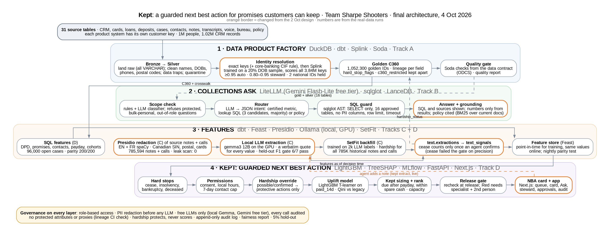

# Kept

**A guarded next best action for promises customers can keep.** Team Sharpe Shooters · CIBC Collections Hackathon.

Collections data at Maple Bank is spread over 31 tables in five systems, none sharing a customer ID, and the facts that
matter most ("lost shifts, can pay 50 on the 15th") sit in free-text notes and calls. So treatment is generic and
promises fall due before payday, then break. Kept unifies the data into one record per person, lets anyone ask it
questions in plain English, and recommends the next best action per case: **safety rules first, then an uplift model,
then a promise sized to the customer's payday and spare cash. A person releases every action.**



Full-size: [`docs/architecture/architecture.pdf`](docs/architecture/architecture.pdf) (TikZ source: `architecture.tex`;
orange border = changed from our 2 Oct [design](docs/design/SharpeShooters_SystemDesign.pdf)).

## Deliverables

| # | What | Where |
|---|---|---|
| 1 | Code repo + this README (run it · what changed · AI tools) | here; [run](#run-it) · [changed](#what-changed-from-the-design-and-why) · [AI tools](#ai-tools-we-used-and-for-what) |
| 2 | Architecture diagram | [`docs/architecture/architecture.png`](docs/architecture/architecture.png) / [`.pdf`](docs/architecture/architecture.pdf) |
| 3 | Data contract for the golden C360 | [`contracts/c360_customer.odcs.yaml`](contracts/c360_customer.odcs.yaml): built from the release's example **DC-COLL-001** (owner → `team`, refresh → `slaProperties`, quality rules → `quality` Q1–Q5, allowed uses → `description.usage`, not allowed → `description.limitations`), extended to ODCS v3 with the schema, classifications and protected/PII/proxy lists |
| 4 | Data quality report | [`QUALITY_REPORT.pdf`](QUALITY_REPORT.pdf): 31 tables profiled, 19 issues with counts and fixes, joins, identity resolution, the contract gate |
| 5 | Benchmark answers | [`submission/benchmark_answers.csv`](submission/benchmark_answers.csv), in the format of `labels/benchmark_answers_template.csv`: every released question plus the 15 extras, written by `kept benchmark` with no hand edits ([how](#benchmark-answers)); [`docs/reports/benchmark_report.pdf`](docs/reports/benchmark_report.pdf) |
| 6 | Demo video | link in the submission form |
| 7 | Pitch deck | [`docs/deck/Kept_pitch_deck.pdf`](docs/deck/Kept_pitch_deck.pdf) |

More reports: [business case](docs/reports/business_case.pdf) · [fairness](docs/reports/fairness_report.pdf) ·
[feature drift](docs/reports/drift_report.pdf).

## Results (real data, 12 Oct)

Each result links to the report that produces it; [`JUDGES.md`](JUDGES.md) has the command to reproduce each one.

| Area | Result |
|---|---|
| Evidence | dating a promise to just after payday: **+6.1 pts** of the promised money paid (95% CI 2.8–10.6), measured on the bank's randomised cases; Kept's contact policy **38.6–42.0%** paid in 14 days vs the bank strategy's **32.4–32.5%** ([evidence](docs/reports/evidence.md)) |
| Identity | 3,840,513 source keys → **1,052,300 golden IDs**; precision **99.3%** (300 links by hand), recall **99%** (198 of 200 planted duplicates, no wrong merges) ([quality](QUALITY_REPORT.pdf), [recall](docs/reports/identity_recall.md)) |
| Data quality | contract gate **PASS** on all 8 rules; 19 data issues found, counted and handled ([quality](QUALITY_REPORT.pdf)) |
| Privacy | 785,594 notes and calls redacted before any model, **0** leaks in a full scan |
| Text | **every** extracted field passes F1 ≥ 0.80 on held-out notes and calls; hardship recall **1.00 / 1.00** ([gate](docs/reports/extraction_gate.md)) |
| Voice | Whisper, local: word error rate **9.4%** vs the bank's speech-to-text at 12.4%; hardship from the recording itself F1 **0.98** ([voice](docs/reports/voice_wer.md)) |
| Models | leaky promise feature found and dropped (AUC 0.92 → 0.63, calibrated within 7 pts); ours plus the bank's score beats the bank's alone, 0.728 vs 0.702 (+2.5 points, 95% CI 1.8–3.2; [evidence](docs/reports/evidence.md) §3, §6) |
| Decisions | **96,000** cards a night; payday-dated plans on cards; the pay link asks the customer's payday when the bank doesn't know it |
| Ask | released dev split **21 of 21**; stress suite **35 of 42**; unseen drill **26 of 30**; refusals all right; hybrid search finds French sections; every answer cites its SQL or source ([accuracy](docs/reports/ask_accuracy.md)) |
| Fairness | any-contact ratio **0.87–1.00** on every protected attribute; scrambling all of them changes **0 of 96,000** decisions ([fairness](docs/reports/fairness_report.pdf)) |
| Governance | hash-chained audit trail (`kept audit-verify`); champion/challenger gate; drift report ([drift](docs/reports/drift_report.pdf)) |
| Business | base **$1.55M a year**, year-one ROI **2.4×**, payback ~**2.6 months**; low $0.44M, high $4.27M ([business case](docs/reports/business_case.pdf)) |

## How it works, in one breath

1. **Data product factory** (DuckDB, dbt, Splink, Soda): land raw → clean with tested rules (never guess) → exact keys
   then Splink to one golden ID per person → golden C360 with lineage → contract gate blocks bad loads.
2. **Collections Ask** (LiteLLM, sqlglot, LanceDB): rules refuse protected / bulk / write questions first; certified
   metrics and reviewed SQL templates before any free SQL; dates worked out in code; SQL guarded; every number in the
   answer must be in the result rows; policy, incident and call answers cite their source.
3. **Text + features** (Presidio, local Qwen3.8-27B, SetFit, Feast): redact first; extract hardship / promises /
   disputes with a verbatim quote per value; backfill history with SetFit; cash-flow hardship rule; point-in-time
   features, same values online, parity and drift checks.
4. **Decisioning** (LightGBM, TreeSHAP, MLflow, FastAPI, Next.js): hard stops → permissions → hardship override (all
   rules, no AI) → uplift model → Kept sizing → rank → three plain-English reasons + a release tier. Red needs a
   specialist plus a second person; everything is re-checked at release and audited.

## Run it

Two ways to run Kept. **The demo** needs nothing but this repo (12 in-memory cases). **The real
system** runs the nightly pipeline over the 1M-customer release, then serves every open case.

### 1. Prerequisites

| Tool | Version | Who needs it |
|---|---|---|
| Python + [uv](https://docs.astral.sh/uv/) | 3.12, uv ≥ 0.5 | everyone |
| Node + [pnpm](https://pnpm.io/) | Node 22, pnpm ≥ 10 | the web app |
| [llama.cpp](https://github.com/ggml-org/llama.cpp) `llama-server` (CUDA build) with Qwen3.8-27B `UD-Q3_K_XL` GGUF (~13 GB, `~/models/`) | build of 10 Oct 2026 or later | every model call: the Ask, briefs, text extraction (a GPU with 16 GB VRAM) |
| RAM | 16 GB for serving; **≥ 24 GB for the full nightly** (land peaks at ~7 GB, match at ~15 GB) | the machine that runs `kept nightly` |
| Disk | ~25 GB free (release 7.3 GB, warehouse ~9 GB, exports) | the real system |

### 2. Install

```bash
make setup-all             # every track's libraries (large: pulls torch); or setup + setup-a/-b/-c/-d
make web-setup             # web app (pnpm install in web/)
cp .env.example .env       # then fill it in (below)
```

`.env`, never committed. Free LLMs only:

| Variable | Set it to |
|---|---|
| `KEPT_HOLDOUT_SALT` | **the team's one shared value.** It decides which cases are in the 5% hold-out; every machine must match, and it never changes after go-live |
| `KEPT_TEXT_LLM_MODEL`, `KEPT_ASK_LLM_MODEL`, `KEPT_LLAMACPP_API_BASE` | leave as in `.env.example`: local Qwen3.8-27B on llama.cpp for everything. No API keys |
| `MLFLOW_TRACKING_URI` | `sqlite:///mlflow.db` (MLflow 3 refuses the old `file:./mlruns`) |
| `KEPT_KILL_SWITCH` | `false`; `true` falls every card back to the current strategy |

### 3. The demo (no warehouse needed)

Two terminals:

```bash
make serve-demo            # API on :8000: the real engine and release gate over 12 demo cases
make web                   # web app on :3000, forwarding /api to the API
```

Open <http://localhost:3000>: the landing tells the story; **Run the guided demo** walks the
six-step script. Personas have direct links, e.g. `/signin?as=agent-7&next=/queue`,
`/signin?as=hs-1&next=/approvals`, `/signin?as=tl-1&next=/approvals`, `/signin?as=c-1&next=/audit`.

- Demo mode runs on a business-hours clock (shown in the header) so releases pass the real
  calling-hours check at any time of day. Restarting the API resets the demo cases.
- **Port 8000 taken** (VS Code often holds it): `uv run kept serve --demo --port 8010` and
  `cd web && KEPT_API_URL=http://127.0.0.1:8010 pnpm dev`.
- **From another machine on the network:** `cd web && KEPT_DEV_ORIGINS=<this machine's IP> pnpm dev`,
  then open `http://<ip>:3000`. Without it the dev server serves the page but not its scripts.
- **For the live demo**, use the production build (faster, no dev overlay):
  `cd web && pnpm build && KEPT_API_URL=http://127.0.0.1:8000 pnpm start`.

### 4. The real system

**Data.** Download the release and lay it out under `data/` exactly as [`data/README.md`](data/README.md)
says. Nothing under `data/` is ever committed. Then put the team's hand-over files in place (Drive folder):

| File | Where | Why |
|---|---|---|
| `extractions_880b98c_20261003.parquet` | `data/exports/extractions/` | the SetFit backfill of all 785,594 notes and calls. **Without it the first nightly would send every note through the live model** |
| `redacted_notes_eb00686_20261003.parquet` | `data/exports/redacted_notes/` | every note and call transcript after redaction. The Ask's call summaries ("summarise the most recent call on case X") read the transcripts from it |
| `identity_crosswalk_<run>.parquet` (+ `review_pairs_<run>.parquet`) | `data/exports/identity_crosswalk/` | optional: `kept match` keeps these golden IDs stable; without it the first run assigns new ones. The review pairs fill the steward queue |

**First run on a fresh machine** (each step is its own process; about 20 minutes in all):

```bash
uv run kept nightly --skip score   # land -> silver -> match -> gold -> gate -> extract -> features -> parity
uv run kept features --training    # features one second before every past decision (features_train)
uv run kept train                  # uplift model -> data/exports/models/uplift.pkl, metrics in MLflow
uv run kept score                  # a card for every open case -> nba.cards (96,000 in ~2.5 min)
uv run python scripts/build_policy_index.py   # the Ask's policy search (data/policy + ops events -> LanceDB), once
uv run kept extract --load-redacted           # redacted notes and transcripts -> text.redacted_notes, once
```

**Every night after that:** `uv run kept nightly`. It stops at the first failing step, so a blocked
quality gate publishes no features or cards; resume with `--from <step>`, leave a step out with
`--skip <step>` (e.g. `--skip extract` on a machine without the local model). `kept features` defaults to the
latest 06:00 UTC run, so cards are never stale.

| Step | Command | Owner | What it does |
|---|---|---|---|
| land | `kept land` | A | `data/raw` -> 31 bronze tables |
| silver | `kept build --silver-only` | A | dbt: cleaned silver |
| match | `kept match --train-sample-mod 5` | A | exact links + Splink (trained on a 1-in-5 sample, scores every key) -> crosswalk |
| gold | `kept build --gold-only` | A | crosswalk + extractions -> `gold.c360_customer`, hardship via `hardship.combine` |
| gate | `kept gate` | A | quality rules Q1-Q5; blocks the run on failure |
| extract | `kept extract --new` | C | tonight's new notes -> redaction -> Qwen3.8-27B -> `text.extractions` |
| features | `kept features` | D | dbt features (point in time) -> Parquet -> Feast online store |
| parity | `kept parity` | A | offline vs online features, ≤ 0.1% mismatch |
| score | `kept score` | D | `nba.cards`: one card per open case, one audit event each |

**Reports and monitoring.** Each report is a LaTeX PDF with charts in `docs/reports/` (sources alongside),
built by a script from live queries. Stop `kept serve` first for the ones that read the warehouse.

| Command | Writes |
|---|---|
| `kept gate` then `uv run python scripts/quality_report_full.py` | `QUALITY_REPORT.pdf` (deliverable 4); needs the 300 reviewed pairs in `data/labels/match_pairs.csv` |
| `uv run python scripts/business_case.py` | `docs/reports/business_case.pdf` (raw files only, runs next to `kept serve`) |
| `uv run python scripts/drift_report.py` | `docs/reports/drift_report.pdf`: PSI per feature, tonight vs training |
| `uv run python scripts/fairness_report.py` | `docs/reports/fairness_report.pdf` (compliance-only inputs) |
| `kept benchmark --out … --scorecard …` then `scripts/benchmark_report.py` | the answers CSV (deliverable 5) and `docs/reports/benchmark_report.pdf` |
| `kept map [--draft]` | schema drift of `data/raw` vs the data dictionary; `--draft` asks the local LLM for a mapping an engineer reviews |
| `uv run python scripts/eval_qa.py 100` · `scripts/eval_call_summary.py 100` | QA scoring and call summaries against the release's public labels |
| Add `--render` to the quality, drift and fairness scripts | re-render the PDF from cached numbers, no warehouse needed |

**Start it for a demo** (after the first run; each time the machine starts). Stop `kept serve` before any
batch step (`kept nightly`, `kept gate` ...): the API holds the warehouse while it runs.

```bash
git checkout main && git pull --ff-only && uv sync --all-extras --inexact
make llm                                                                          # terminal 1: Qwen3.8-27B on llama.cpp, :8081 (~15 GB VRAM)
make serve                                                                        # terminal 2: API on :8000, real data (embeddings on the CPU)
cd web && pnpm install && pnpm dev                                                # terminal 3: app on http://localhost:3000
curl -s localhost:8000/health                                                     # "demo": false means real data
```

Open <http://localhost:3000> (use `localhost`, not `127.0.0.1`), then **Guided demo**, or sign in as a persona:
`/signin?as=agent-7&next=/queue` (agent, works agent AG-8365's queue on real data),
`/signin?as=hs-1&next=/approvals` (hardship specialist), `/signin?as=tl-1&next=/approvals` (team lead),
`/signin?as=c-1&next=/audit` (compliance), `/signin?as=an-1&next=/ask` (analyst),
`/signin?as=ds-1&next=/steward` (data steward). The Ask runs on the local model:
`make llm` must be up (`curl localhost:8081/health`).

**Serve it** (the API owns the warehouse while it runs: no batch jobs against it at the same time):

```bash
uv run kept serve          # API on :8000 over the real services
make web                   # or the production build above
```

- `/queue` reads the nightly's cards (an agent sees their own cases); opening a case re-checks it live.
- **Add a note** on a case runs live extraction (Presidio + Qwen3.8-27B, a few seconds) and re-checks the card:
  a hardship note turns it Red. A possible cease request shows a red banner the assigned agent confirms.
- The Ask answers with the local model; policy questions cite the section.
- Without Presidio installed (`make setup-c`) adding a note answers 503; everything else works.

### Before a live demo

```bash
uv run kept preflight      # go/no-go: API, warehouse lock, fresh features, the local models (warmed), web
uv run kept demo-reset     # with kept serve stopped: removes notes typed in earlier demos, so cards reset
```

### Benchmark answers

```bash
# the released questions plus the 19:00 extras, one questions CSV (same columns as data/benchmark_questions.csv)
uv run kept benchmark --questions data/benchmark/benchmark_questions.csv   # -> submission/benchmark_answers.csv
```

`kept benchmark` opens the warehouse read-only, so stop `kept serve` first (DuckDB allows one writer). With the server running,
the **Bench** page in the web app does the same thing question by question (same rows, same format) and exports the CSV:
load or drop a questions CSV, press Run, then *Answers CSV*. `benchmarks/` holds our own 42-question stress suite with gold.

### 5. Tests

```bash
make test-contract         # shared API: always green
make test                  # the full suite (1,100+ tests)
make lint typecheck
cd web && pnpm lint && npx tsc --noEmit
```

## What changed from the design, and why

- **UI (D):** a Next.js app with Radix Themes instead of the plan's single static page, so the
  demo covers every role's flow (queue, approvals, audit, Ask) and the guided script. It needs
  Node on the demo machine.
- **Red-tier release in two steps (D):** a hardship specialist approves, then a second person
  releases after a fresh safety recheck, instead of both names on one form. The handoff is real:
  the proposal waits in the second person's inbox.
- **Safety checks run at the proposed contact time (D):** a 06:00 batch would otherwise block
  every call; the release gate rechecks everything again at release.
- **SHAP from LightGBM itself (D):** `pred_contrib` instead of the `shap` package, converted to
  probability points per feature.
- **Feast offline store is `file` (D):** the DuckDB offline store needs `ibis`; the file store reads
  the same Parquet export.

- **Core-banking customer number as an exact link (A):** not in the design; it comes from the release README.
  `deposit_accounts.src_customer_ref = external.bank_subject_ref`, and for the 495,420 keys in both tables name,
  DOB and postal code agree 99.7 to 100%.
- **Payment accounts at other banks don't link (A):** 64.7% of card autopay and loan PAD source accounts are not
  our deposit accounts, so they are ignored for matching instead of linking strangers.
- **Ambiguous dates of birth are never guessed (A):** 12.7% of CRM DOBs could be DD/MM or MM/DD. Reading them all
  day-first misreads 16%, which could merge two people; they stay null and other fields carry the match.
- **Loan names in either order (A):** 20% of loan borrower names are "Last First"; the token CRM uses more as a
  surname is taken as the surname (`silver.int_name_lexicon`).
- **Match precision measured by a person (A):** the organisers gave no ground-truth IDs, so a person reviewed 300
  random predicted links (160 Splink, 140 exact) sorted into review tiers: 298 correct, **99.3%** (target 98%).
  Both misses were Splink links with different surnames. Splink also re-finds 99.9% of the exact links on its own.
- **Golden IDs stay stable (A):** `kept match` reuses the last crosswalk: the oldest ID survives a merge, the
  largest part keeps its ID on a split, and IDs are never reused. Steward verdicts feed back into the next match
  ("same person" links, "different people" cuts the link).
- **The contract is enforced, not just written (A):** gold models have dbt contract enforcement (a wrong type
  fails the build), and the Soda checks are generated from the ODCS contract (21 of 21 pass).
- **Silver keeps source labels where the contract is coarser (A):** buckets like 121-150 stay in silver; gold
  derives its bucket from days past due. Province spellings (Ont., B.C., PQ ...) are normalised.
- **Reloading the backfill never undoes a person (A, found with C):** the extraction loader only replaces a row
  with a newer one, and never drops an agent's confirmation.

- **Text extraction runs on a local model (C):** Qwen3.8-27B through llama.cpp on the team's GPU,
  not a hosted API: no rate limits, no cost, and note text never leaves the machine. Every value
  needs a verbatim quote from the note, or it is dropped.
- **Cease from text needs an agent's confirmation (C):** cease failed the F1 gate on precision
  (held-out 0.50 notes, 0.20 calls; 1–2 true cases each), so an extracted cease is shown as
  "possible cease: confirm" and only becomes a hard stop once an agent confirms it
  (`/extractions/{id}/confirm`). The other six text features passed the gate.
- **SetFit backfills hardship only (C):** the 785,594 historical notes and calls get a hardship
  signal from SetFit trained on 1,604 LLM labels (held-out recall 0.98 notes, 0.99 calls);
  promises, disputes and cease come from structured tables for history, and from the LLM for new notes.
- **French-aware redaction (C):** 14% of notes are French, so Presidio runs a French spaCy model on
  them; card numbers and DOBs are caught even when the synthetic data mangles them. A scan of all
  785,594 redacted texts finds no leftover cards, phones, emails, SINs, postal codes or DOBs.
- **Splink trained on a 20% sample (A, run by C):** EM over all 3.84M keys didn't finish or fit in
  RAM; training on a 1-in-5 DOB-hash sample and scoring every key gives 1,052,300 golden IDs.
- **Cash-flow hardship from deposit data (C):** late payroll, a 20% pay drop or new EI deposits
  add a possible-hardship observation to gold (`hardship.cashflow_observations`).
- **Post-call summary (C):** `kept.text.calls.summarise_call` reads a case's newest redacted transcript; the LLM
  fills structured fields and fixed code writes the sentence. The template reproduces all 500 public gold
  summaries exactly from their labels; with the local model, 77 of 100 labelled calls match word for word.
- **Decimals are not personal data (C):** the redactor read long decimals in Ask result rows (0.42059…) as card or
  phone numbers; digits inside a decimal are never redacted now.
- **Voice is not built (C):** the design's planned cut (§10, "drop the semantic layer first, then voice"). All
  25,000 calls already come as transcripts and go through the same redaction and extraction;
  `kept/text/transcribe.py` stays a stub.
- **The demo runs on real data (C, in D's web app):** the guided demo uses a real case and agent when the server
  is not in demo mode, and the agent persona works a real agent's queue (179 open cases).

- **The Ask on a local model (B):** Qwen3.8-27B on this machine (llama.cpp, through LiteLLM), like text extraction. It
  began on a free hosted tier; since 14 October everything is local: no API keys, no quota, and no question leaves the
  machine. Every question is still redacted (Presidio) before any LLM call, and each call is logged without the
  prompt text.
- **Certified SQL for 14 of 15 metrics (B):** the metric definitions' formulas are pseudo-SQL, so each
  certified metric is hand-translated to reviewed SQL and the LLM never writes it. `write_off_rate` is
  not certified: its period bounds only the numerator, and one date column cannot express that. That SQL
  also goes through the SQL guard before it runs.
- **Lookups are voted and repaired (B):** three SQL drafts, the result shared by a majority wins, and a
  draft that will not run gets one repair round in which the model sees the database error. Without it,
  one bad draft left the other two disagreeing and the Ask refused.
- **Policy search is keyword search, not embeddings (B):** LanceDB full-text (BM25) over the 19 policy
  documents: no model download, and only sections current on the asked date are returned, so a superseded
  version is never cited. Policies and procedures outrank FAQs and call scripts when they disagree.
- **Numbers must come from the rows (B):** a narrative whose numbers are not in the result is dropped and
  replaced by "the result is in the table", so the Ask never states a figure the query did not return.
- **Where the reference answers take a shortcut, we follow them (B):** the roll rate reads
  `month_end_date` the way the reference does (it skips the MM/DD/YYYY spelling, 3.3% of rows), and two
  other dev questions group the way the reference does. Everywhere else the Ask computes from cleaned data.
- **Call summaries and incidents (B, with C):** "summarise the most recent call on case X" is answered from
  that call's redacted transcript by Track C's `summarise_call`, before the scope check (which saw "personal
  data" in it); a case with no recorded call gets "there is no recorded call", not a refusal. "Why did X
  change on that day" is answered from the incident reports and the operations-events table (indexed with
  the policies).
- **Fairness report on the real cards (B):** `docs/reports/fairness_report.pdf` compares recommendations across the
  protected attributes in `gold.c360_restricted` (compliance only); a blank attribute is reported, not
  treated as a group.

## AI tools we used, and for what

- **Claude (Claude Web and Claude Code):** pair-programming the code and tests across the stack (data
  pipeline, Ask, text and hardship, NBA engine, web app), running and monitoring the heavy GPU jobs and the
  benchmark, tuning prompts and certified SQL from what the benchmark showed, and writing the reports and deck.
  Every change went through the tests and a person's review before merging.
- **Qwen3.8-27B (local, llama.cpp):** extracts the text features from redacted notes and answers the Ask (Gemma 3 12B
  labelled 1,604 notes to train SetFit earlier). Tuned and gated on the release's public labels (30% held out).
- **SetFit (`BAAI/bge-small-en-v1.5`):** the fast classifier that backfills hardship for all history.
- **Qwen3.8-27B in the Ask:** the scope check, question routing, SQL drafting for lookups, judging drafts that
  disagree, and plain-English narration of results. Its output is checked by code: intent checks and a convention
  linter, the SQL guard before anything runs, and the grounding check on every number (`docs/reports/ask_accuracy.md`).

## Layout

```text
QUALITY_REPORT.pdf                  deliverable 4
contracts/c360_customer.odcs.yaml   deliverable 3: data contract (ODCS, from DC-COLL-001)
docs/
  architecture/   deliverable 2: architecture.png / .pdf, drawn in TikZ (architecture.tex)
  reports/        business case, fairness, drift, benchmark, quality: PDFs + LaTeX sources + figures
  deck/           deliverable 7: the pitch deck
  design/         our 2 Oct system design
  brief/          the organisers' brief, build instructions and data dictionary
  team/           TEAM_PLAN.md and each track's log (how we split and integrated the work)
src/kept/
  contracts/      fixed API between tracks: models, enums, Protocols, feature registry
  config.py       every threshold the design commits to
  common/         LLM gateway (LiteLLM), audit log, DuckDB connection
  data/           Layer 1  ingest, clean, traps, identity/, gold, quality, mapping assistant   (A)
  ask/            Layer 2  scope, router, metrics, templates, lookup, policy, SQL guard        (B)
  text/           Layer 3  redaction, extraction, call summaries, QA scoring, SetFit backfill  (C)
  hardship/       hardship combination, cash-flow rule, programme eligibility                  (C)
  governance/     lineage CI check, fairness (C); role access and masking (D)
  features/       Layer 3  feature definitions, Feast provider, drift (D); parity (A)
  nba/            Layer 4  rules, uplift, sizing, ranking, explain, tiers, release, engine     (D)
  app/            FastAPI routes
  cli.py          `uv run kept <step>`
scripts/          report builders (reportlib.py + one per report), evaluations, one-off jobs
dbt/              bronze -> silver -> gold -> features (DuckDB)
feature_repo/     Feast
soda/             Soda checks, generated from the contract
web/              Next.js app (queue, card, approvals, Ask, steward, audit, guided demo)
tests/            mirrors src/; tests/fakes.py has a fake for every interface
data/             local data only (git-ignored)
```

## Stack

DuckDB, dbt, Splink, Soda (Layer 1) · LiteLLM, sqlglot, LanceDB (Layer 2) · Presidio, spaCy, Qwen3.8-27B (llama.cpp), SetFit,
Feast (Layer 3) · LightGBM, TreeSHAP, MLflow, FastAPI, Next.js (Layer 4) · pandoc + XeLaTeX for the reports.
Python 3.12 with `uv`; each track's libraries are an optional extra in `pyproject.toml`.
